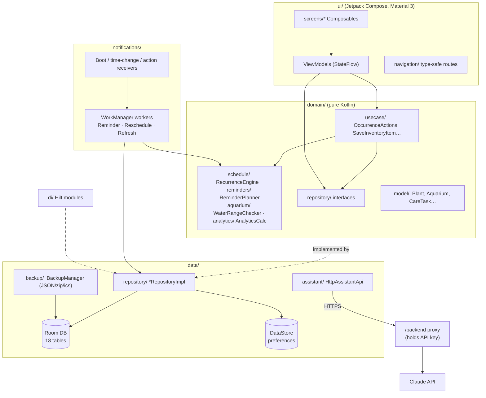

<h1 align="center">🌱🐠 AquaGrow – My Garden & Aquarium</h1>

<p align="center"><b>An offline-first Android app to care for your terrace garden and home freshwater aquariums.</b></p>

<p align="center">
       
</p>

<p align="center"><a href="https://github.com/joker7866/aquagrow/releases/latest"></a></p>

---
An offline-first Android app for a terrace garden and home freshwater aquariums. It has no account, no ads and no tracking, and works fully without internet.

## Features

**Garden**
- Plants with photos, a growth-stage tracker, and harvest windows shown as estimates.
- A catalog of 20 common plants with care tips and sowing seasons.
- Watering and fertilizer logs.
  - Watering reminders ask you to check the soil; the app never suggests a fixed interval.
  - Fertilizer amounts always come from the product label.
- Growth notes, harvest records and a seed and harvest planner.

**Aquarium**
- Tanks with volume calculated from their dimensions, equipment details and preferred water ranges.
- Fish, with a 10-species catalog and compatibility hints.
- Feeding schedules, water-test logs with trend charts, and maintenance logs.
- Out-of-range alerts that compare readings with your ranges and never claim a diagnosis.

**Planning and reminders**
- Calendar with daily, weekly and monthly recurring tasks.
- Mark tasks done, skip, reschedule or snooze them.
- Notifications with Done and Snooze actions.
- Quiet hours, no duplicate reminders, and reminders that survive reboots and time-zone changes.

**Tools**
- Inventory with low-stock and expiry reminders.
- Expenses: buying an item with a cost records an expense automatically. ₹ INR is the default and can be changed.
- Analytics built only from your real data; screens without enough data say "Not enough data yet".
- Photo gallery with filters, and search across plants, fish, tanks, tasks and notes.
- Backup to JSON, or zip with photos, through the system file picker.
- Restore with validation, then a choice of replace or merge.
- Calendar export to `.ics`.

**Optional AI assistant**
- Garden and Aquarium assistants with starter questions.
- Optional plant or tank context, recent logs and photos.
- Off by default; turning it on requires explicit consent.
- Calls your own backend (see [`/backend`](backend/README.md)). There is no API key in the app.
- Falls back to the built-in care tips when offline.

**Design**
- Material 3 with a garden palette (green) and an aquarium palette (blue).
- Light and dark themes; all colour pairs meet WCAG AA.
- Outfit and DM Sans fonts and outlined Material Symbols.
- Supports TalkBack labels, 48 dp touch targets and 200% font size.

## Screenshots

_Add screenshots here before publishing, for example from a Pixel emulator:_

| Home | Garden | Plant | Aquarium | Tank | Calendar |
|---|---|---|---|---|---|
| `docs/screens/home.png` | `docs/screens/garden.png` | `docs/screens/plant.png` | `docs/screens/aquarium.png` | `docs/screens/tank.png` | `docs/screens/calendar.png` |

## Architecture

MVVM with clean-architecture layers in one module (`com.aquagrow`). UI talks to ViewModels; ViewModels use domain use cases and repository interfaces; the data layer implements them with Room, DataStore and WorkManager.



**Key decisions**

- **Task occurrences are calculated, not stored.**
  - Only the recurrence rule and per-day state (done, skipped, rescheduled, snoozed) are saved.
  - This keeps changing a schedule cheap and keeps the database small.
- **Time-zone-free storage.** Dates are stored as epoch days, times as seconds of the day, instants as epoch milliseconds, and money in minor units.
- **One reminder job per occurrence.**
  - Each reminder is scheduled as unique WorkManager work, keyed `rem-{task}-{date}`.
  - Before posting, the worker checks the task again and records it in a log keyed so it can't post twice.
  - Quiet hours delay reminders; they never drop them.
- **Backups include the schema version.**
  - Restore checks the format, the schema, duplicate ids and every foreign key before writing anything.
  - Replace runs in a single transaction; merge remaps ids.

**Tech:**
- Kotlin 2.4 and AGP 9.4.
- Jetpack Compose (BOM 2026.09), Material 3, Navigation Compose with type-safe routes.
- Hilt, Room 2.8, DataStore, WorkManager.
- Coroutines and Flow, kotlinx-serialization.
- CameraX and the Photo Picker, Coil 3, core-splashscreen.
- minSdk 26, targetSdk 36, compileSdk 37.

## Build

You need:
- JDK 17 or newer.
- The Android SDK with platform 37.

```bash
./gradlew assembleDebug          # debug APK
./gradlew bundleRelease          # release AAB (R8 + resource shrinking)
```

### Release signing

Create `keystore.properties` in the project root. It is git-ignored; never commit it.

```properties
storeFile=/absolute/path/to/aquagrow-release.jks
storePassword=...
keyAlias=aquagrow
keyPassword=...
```

Without this file, `bundleRelease` still builds, but the bundle is unsigned. To try the minified build on a device or emulator, run `./gradlew assembleRelease -PsignReleaseWithDebugKey`.

The version is set in `app/build.gradle.kts` (`versionCode`, `versionName`).

## Tests

```bash
./gradlew testDebugUnitTest             # 119 JVM unit tests
./gradlew connectedDebugAndroidTest     # 7 instrumented tests (needs a device/emulator)
cd backend && npm test                  # 7 backend tests
```

**Unit tests cover:**
- recurrence and occurrence resolution, reminder planning, quiet hours and duplicate prevention;
- harvest estimates, validators, water ranges, compatibility and feeding schedules;
- analytics and expense totals, inventory-to-expense sync;
- backup JSON round-trip and validation;
- the assistant repository (against a fake API) and ViewModels.

**Instrumented tests** (each runs on a fresh install via the Android Test Orchestrator):
- end-to-end UI flows: onboarding, add plant, mark task done, log water test, backup screen;
- the Room migration pattern (`MigrationTest`);
- a backup round-trip through a real SQLite database.

**Database changes after release:**
1. Add a `Migration` to `data/local/db/Migrations.kt`.
2. Bump the database version.
3. Commit the new schema JSON from `app/schemas/`.
4. Extend `MigrationTest`.

**Code style:** ktlint, configured in `.editorconfig` (Android Studio style), and Android Lint.

## AI assistant backend

The app never contains an AI key. To enable the assistant:

1. Deploy [`/backend`](backend/README.md), a small Node/Express proxy. Set `ANTHROPIC_API_KEY` in the host's environment.
2. Put its HTTPS URL in `assistant.properties` (`baseUrl=https://…`), or override it locally in `local.properties` (`assistant.baseUrl=…`).
3. Build the app. Users turn the assistant on in Profile.

If no URL is set, the assistant screens say "not set up" and the rest of the app works as usual. For local testing, debug builds may use `http://10.0.2.2:8787`.

## Privacy

See [PRIVACY.md](PRIVACY.md). In short: data stays on the device, and only the optional assistant uses the network.

## Licences

- Outfit and DM Sans fonts: SIL Open Font License (see `licenses/`).
- Material Symbols: Apache 2.0.


---

## 👨‍💻 Author

**Kishore** — B.Tech Computer Science · Software developer building practical apps for everyday problems in Tamil Nadu and India.

- GitHub: [@joker7866](https://github.com/joker7866)

<p align="center"><sub>⭐ If you find this project useful, consider giving it a star!</sub></p>
